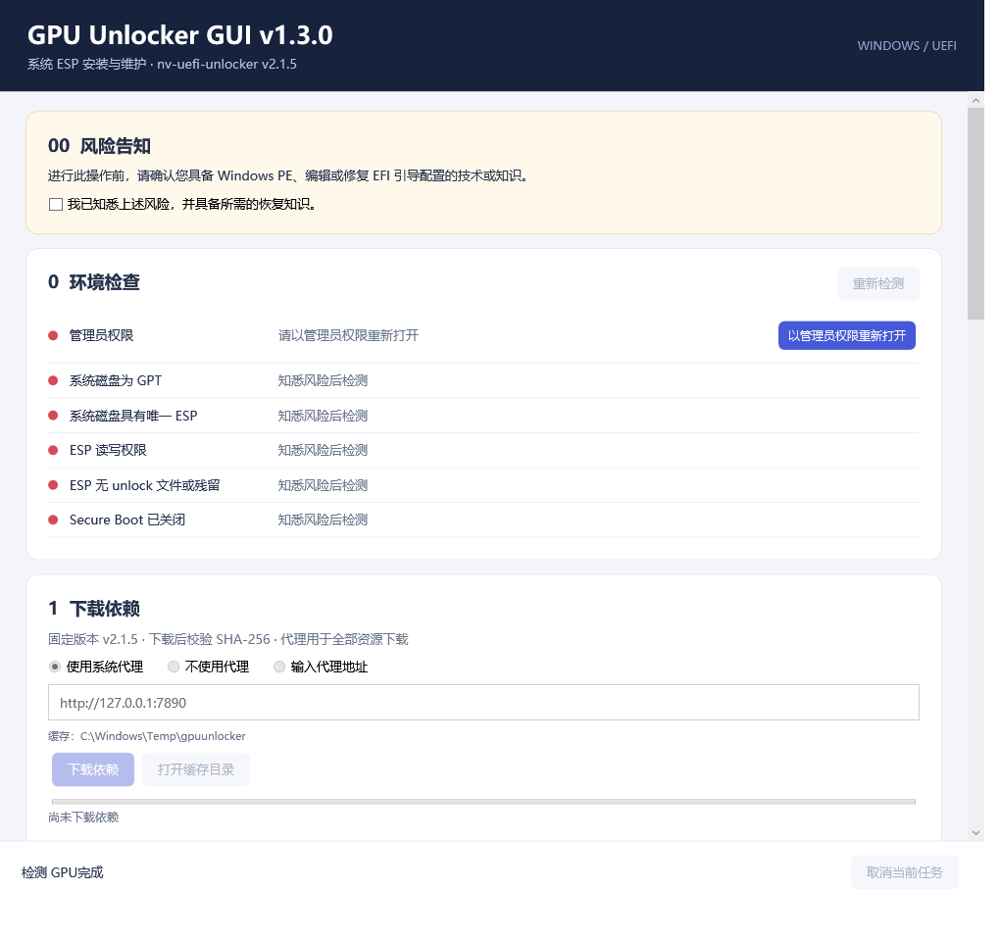
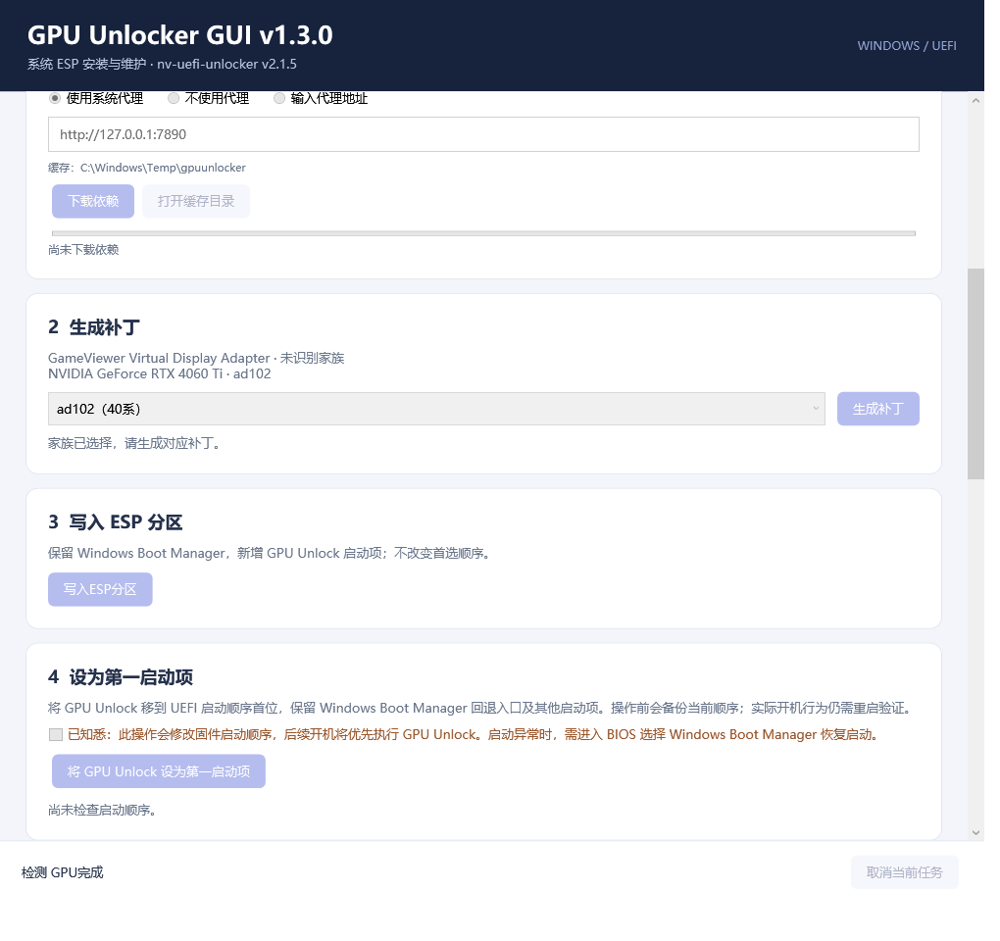
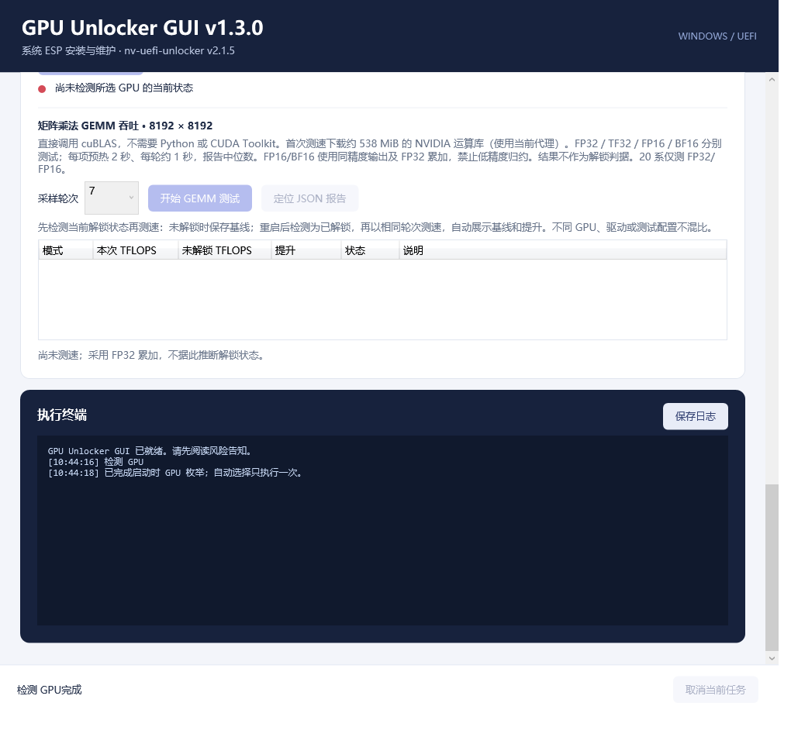

# GPU Unlocker GUI

[简体中文](readme.cn.md) | English

**Current version: v1.3.0** (2026-10-30)

GPU Unlocker GUI is a Windows desktop application for installing a GPU unlocker at boot, detecting the current unlock status, and benchmarking FP32 / TF32 / FP16 / BF16 performance before and after unlocking.

Release packages are single, self-contained executables. Run `GPU-Unlocker-GUI-v1.3.0.exe` directly; no separate .NET installation is required. Executable names include the actual version. Nightly builds use names such as `GPU-Unlocker-GUI-v1.3.0-nightly.RUN_NUMBER.exe`. Unlock resources and benchmark libraries are downloaded on demand. Python and CUDA Toolkit are not required.

To trigger a Nightly build manually, go to **Actions → Nightly build and release → Run workflow**. After the tests pass, the workflow updates the [nightly prerelease](https://github.com/cpuopt/gpu-unlocker-gui/releases/tag/nightly) with the executable, SHA-256 checksums, and dependency manifest. Versions follow `1.3.0-nightly.RUN_NUMBER`; each successful build replaces the previous Nightly.



## Language

Use the **中文 / English** selector in the upper-right corner to switch the interface immediately. The first launch follows the Windows UI language: Chinese for Chinese locales and English otherwise. Your selection is saved for subsequent launches, including restarting as administrator. Switching language preserves the current task, selections, and risk acknowledgments.

The interface uses the standard .NET `ResourceManager`, `.resx` files, and satellite resource assemblies, with English as the resource fallback. Resources are in `src/GpuUnlocker.App/Resources/Strings.resx` and `Strings.zh-CN.resx`. Original backend, third-party tool, and system diagnostic output is preserved in the execution log; some detailed diagnostic messages may remain in their original language. JSON reports and baseline identifiers retain their existing format.

## Usage

Requirements: **Windows x64, an NVIDIA driver, and GPT/UEFI boot**. Disable **Secure Boot** in BIOS before installation. The installation workflow primarily targets NVIDIA 20 / 30 / 40-series GPUs; compatibility depends on upstream support and the application's checks. The 20 series also requires the upstream GSP prerequisites.

Installation writes to the system EFI partition. Before proceeding, you should know how to enter BIOS and select a boot entry.

1. Open the application, read the risk notice, and acknowledge it. Restart as administrator when prompted.
2. Run **Environment checks** and address any failed checks.
3. Choose a proxy setting and click **Download dependencies**. Failed downloads can be retried.
4. Confirm the GPU family and click **Generate patch**.
5. Click **Install to ESP**, then verify the installation. If an existing patch or remnants are detected, use **Remove unlock patch** first.
6. In **Set boot priority**, accept the separate risk notice and click **Set GPU Unlock as first boot entry**. The application backs up the current order, applies the change, and reads it back for verification, keeping the Windows fallback entry. Installing to ESP alone does not change boot priority.
7. Click **Verify patch and configuration** to check the files, boot entries, and current boot order, then restart Windows. If the motherboard does not retain the setting, select GPU Unlock manually in BIOS.
8. Back in the application, select the GPU under **Runtime status and benchmark**, then click **Detect current unlock status**.

<details>
<summary>Boot priority settings</summary>



</details>

Installation verification checks files and boot configuration. Actual unlock status is determined by runtime detection after restarting. Detection temporarily loads an upstream driver; wait for detection and cleanup to finish. If the status cannot be determined, see the execution log at the bottom of the interface.

Installation validity and boot priority are shown separately. If BIOS, Windows, or another application changes the boot order, verification shows whether GPU Unlock is still first and whether the Windows fallback entry remains in the order. A one-time boot sequence is reported separately because it may take precedence on the next boot.

## Benchmarking and comparison



Select a GPU and click **Start GEMM test**. The default is the **median of 7 rounds**; 11 and 15 rounds are also available. The first run downloads about **538 MiB** of compute libraries, which are cached for later runs. Close other GPU workloads before testing to reduce interference.

The comparison uses a benchmark from the locked state as its baseline:

1. **Before unlocking:** detect the GPU as locked, then complete a benchmark. The application saves the baseline automatically.
2. **After unlocking:** restart, detect the GPU as unlocked, and benchmark with the same round count.
3. The table shows **current TFLOPS, locked TFLOPS, and percentage gain**. Baselines persist across restarts.

If the GPU is already unlocked and no baseline exists, select **Windows Boot Manager** at boot to start Windows directly. Confirm the locked state before benchmarking. A different GPU, driver, or test configuration requires a matching new baseline.

Before comparing, the application checks device identity, driver, and configuration. If no valid baseline exists, the unlock state is unknown, or the GPU was busy before testing, the gain column is left empty and the reason is displayed. TFLOPS values measure performance; runtime detection determines unlock status.

## Uninstalling and recovery

The original Windows boot entry is preserved.

- **Normal uninstall:** click **Remove unlock patch**. The application identifies boot entries by device, path, and installation record, removes their persistent and one-time boot references, then removes the files. It preserves the relative order of other entries and the Windows fallback. If firmware changes cannot be verified, ESP files are retained and the application asks you to retry.
- **Boot problems:** open the BIOS boot menu and select the original **Windows Boot Manager**.
- **Backups:** `%ProgramData%\GPUUnlocker\Backups`.
- **Benchmark reports and baselines:** the `Reports` and `Baselines` folders under `%LocalAppData%\GPUUnlocker`.
- **Language preference:** `%LocalAppData%\GPUUnlocker\language.txt`.

## How it works

The application deploys the upstream EFI unlocker to the existing system partition and adds a **GPU Unlock** boot entry. A separate, explicitly acknowledged step uses Windows BCDEdit to change the UEFI firmware boot order. Booting through this entry runs the unlocker before starting Windows. The original Windows boot entry is retained, and partitions are not resized or rearranged.

Runtime detection uses upstream `ssdiag` to read the selected GPU's current unlock verdict. Benchmarking calls NVIDIA cuBLAS directly for `8192 × 8192` dense matrix multiplication. Each mode warms up for 2 seconds, measures TFLOPS with GPU timing, and validates sampled results against reference dot products. FP32 and TF32 are tested separately; FP16/BF16 use FP32 accumulation. These results measure matrix throughput; application and model performance depend on the workload.

## Projects and references

- [nv-uefi-unlocker v2.1.5](https://github.com/physicsdolphin/nv-uefi-unlocker/releases/tag/v2.1.5): the EFI unlocker, resource generator, and `ssdiag`, downloaded on demand.
- [cmp50hx-unlock](https://github.com/xrip/cmp50hx-unlock): an upstream boot resource used by the 20-series workflow.
- [NVIDIA cuBLAS](https://developer.nvidia.com/cublas): matrix multiplication benchmark library, pinned to 12.8.4.1 and downloaded before the first benchmark.
- [.NET / WPF](https://github.com/dotnet/wpf): desktop UI and runtime. The release executable includes .NET; system operations use Windows PowerShell.
- [PyTorch CUDA BLAS implementation](https://github.com/pytorch/pytorch/blob/v2.9.0/aten/src/ATen/cuda/CUDABlas.cpp): a reference for benchmark calls, not a runtime dependency.

This project provides the desktop interface, dependency management, installation and recovery, benchmarking, and result comparison. The actual unlock logic comes from upstream. See [THIRD-PARTY-NOTICES.md](THIRD-PARTY-NOTICES.md) for component and licensing information.

## Versioning and pinned dependencies

Releases use `MAJOR.MINOR.PATCH`: incompatible changes increment the major version, compatible features increment the minor version, and fixes or documentation updates increment the patch version when released. **v1.3.0** adds a separately acknowledged boot priority setting and improves detection and removal after boot order changes. GEMM measurement, 7/11/15-round sampling, and baseline comparison retain the existing protocol. GUI and upstream unlocker versions are managed independently.

| Component for v1.3.0 | Pinned version / relationship |
| --- | --- |
| nv-uefi-unlocker, including EFI, generator, and ssdiag | **v2.1.5**; SHA-256 verification of the complete release archive |
| Firmware generation inputs | NVIDIA **610.43.03**, CachyOS tools **610.43.03-1**; users are not required to install this driver version |
| cuBLAS benchmark libraries | **12.8.4.1**; SHA-256 verification of archive and DLLs |
| cmp50hx-unlock 20-series boot resource | No declared version; pinned by file SHA-256 |
| .NET SDK / bundled runtime | **10.0.403 / 10.0.14**, pinned at build time |
| PyTorch | **v2.9.0**, reference only; no runtime installed or bundled |
| Historical MMA kernel build tools | ptxas **12.8.93**; not used by the current GEMM benchmark |
| Windows PowerShell / NVIDIA driver | System PowerShell **5.1**; driver is not pinned, but comparisons require the same version |

The application version is defined in [Version.props](Version.props). Download URLs and file hashes are recorded in [dependencies.lock.json](dependencies.lock.json). When upgrading dependencies, update both the manifest and code, then run `powershell -File tools/check-versions.ps1`; CI verifies their consistency. Changes to the benchmark methodology also require updating the test protocol to prevent comparisons across incompatible baselines.

## Building and localization checks

Use the pinned SDK from `global.json`. If needed, install it locally with `powershell -File tools/bootstrap-sdk.ps1`, then use `.tools\dotnet\dotnet.exe` in place of `dotnet`.

```powershell
dotnet build GpuUnlocker.sln -c Release
dotnet run --project tests/GpuUnlocker.Tests -c Release
dotnet src/GpuUnlocker.App/bin/Release/net10.0-windows/GpuUnlocker.dll --smoke-test
powershell -File tools/check-versions.ps1
```

The UI smoke test checks both languages and captures the main screen, boot priority section, and benchmark section without installing a patch or modifying boot configuration. To add interface text, add matching keys to both `.resx` files. Use resource bindings in XAML and deferred `Localization.T(key, args)` messages in C# so displayed messages update when the language changes. The implementation follows Microsoft's [ResourceManager and satellite resource model](https://learn.microsoft.com/en-us/dotnet/core/extensions/resources).
